 

 

## 🧭 이 저장소는

부트캠프 수업, 실제 프로젝트의 **기술 결정 로그**, 기술 블로그 정리를 하나의 옵시디언 Vault로 관리하는 지식 저장소입니다.
옵시디언이 원본이고, GitHub에는 **30분마다 자동 커밋**, Notion에는 미러링됩니다.

 

## 🕸 Knowledge Graph

> 노트 사이의 `[[위키링크]]`를 그대로 그린 지도입니다. 색은 서가, 크기는 연결 수, 맥박 치는 점은 허브(MOC) 노트입니다.

 

## 📚 서가

<!-- SHELVES:START -->
| 서가 | 노트 | 들어가기 |
| --- | ---: | --- |
| **KDT 수업 노트** | 152 | [KDT_2026 학습 지도](https://github.com/SeungMinShin01/obsidian-til/blob/main/KDT_2026%20%ED%95%99%EC%8A%B5%20%EC%A7%80%EB%8F%84.md) |
| **기술 블로그 정리** | 156 | [기술정리 MOC](https://github.com/SeungMinShin01/obsidian-til/blob/main/%EA%B8%B0%EC%88%A0%EC%A0%95%EB%A6%AC/%EA%B8%B0%EC%88%A0%EC%A0%95%EB%A6%AC%20MOC.md) |
| **프로젝트 결정 로그** | 90 | [프로젝트 노트 MOC](https://github.com/SeungMinShin01/obsidian-til/blob/main/%ED%94%84%EB%A1%9C%EC%A0%9D%ED%8A%B8%20%EB%85%B8%ED%8A%B8/%ED%94%84%EB%A1%9C%EC%A0%9D%ED%8A%B8%20%EB%85%B8%ED%8A%B8%20MOC.md) |
| **프로젝트 코드 분석** | 25 | [프로젝트 코드 분석 안내](https://github.com/SeungMinShin01/obsidian-til/blob/main/%ED%94%84%EB%A1%9C%EC%A0%9D%ED%8A%B8%20%EC%BD%94%EB%93%9C%20%EB%B6%84%EC%84%9D/%ED%94%84%EB%A1%9C%EC%A0%9D%ED%8A%B8%20%EC%BD%94%EB%93%9C%20%EB%B6%84%EC%84%9D%20%EC%95%88%EB%82%B4.md) |
| **코드 레퍼런스** | 107 | [코드정리](https://github.com/SeungMinShin01/obsidian-til/blob/main/%EC%BD%94%EB%93%9C%EC%A0%95%EB%A6%AC/%EC%BD%94%EB%93%9C%EC%A0%95%EB%A6%AC.md) |
| **운영 규칙** | 29 | [Vault 홈](https://github.com/SeungMinShin01/obsidian-til/blob/main/Vault%20%ED%99%88.md) |
<!-- SHELVES:END -->

 

## ⭐ 추천 시리즈

<table>
<tr>
<td width="50%" valign="top">

**🏗️ WMS 기술 결정 로그**

3주 팀 프로젝트의 선택마다 *문제 → 대안 → 선택 근거 → 기각 사유* 를 남긴 기록.
도커, 패키지 구조, 격리수준과 재고 정합성, JPA vs MyBatis, 1GB 서버 배포까지.

`Spring Boot` `MySQL` `Docker` `Flyway`

→ [WMS 프로젝트 MOC](%ED%94%84%EB%A1%9C%EC%A0%9D%ED%8A%B8%20%EB%85%B8%ED%8A%B8/WMS%20%ED%94%84%EB%A1%9C%EC%A0%9D%ED%8A%B8%20MOC.md)

</td>
<td width="50%" valign="top">

**💬 RAG 챗봇**

PDF 업로드부터 검색까지의 전체 흐름, 페이지 경계 처리, 영어 문서에 한국어로 질문하기, 거리 측정 방식과 1536차원 임베딩.

`Python` `Embedding` `Vector Search`

→ [RAG 챗봇 프로젝트 MOC](%ED%94%84%EB%A1%9C%EC%A0%9D%ED%8A%B8%20%EB%85%B8%ED%8A%B8/RAG%20%EC%B1%97%EB%B4%87%20%ED%94%84%EB%A1%9C%EC%A0%9D%ED%8A%B8%20MOC.md)

</td>
</tr>
<tr>
<td width="50%" valign="top">

**🤖 채용공고 수집기**

GitHub Actions로 무인 구동하는 수집 파이프라인. 워크플로우 설계, 트리거, 저장 계층을 번호 트리로 기록.

`GitHub Actions` `Python` `SQLite`

→ [수집기 프로젝트 MOC](%ED%94%84%EB%A1%9C%EC%A0%9D%ED%8A%B8%20%EB%85%B8%ED%8A%B8/%EC%88%98%EC%A7%91%EA%B8%B0%20%ED%94%84%EB%A1%9C%EC%A0%9D%ED%8A%B8%20MOC.md)

</td>
<td width="50%" valign="top">

**🔍 보드게임카페 예약사이트 코드 분석**

실제 프로젝트 코드를 파일 단위로 읽고 개발자 일지 + 학습 관점으로 정리.

`React` `Express` `MySQL`

→ [분석 MOC](%ED%94%84%EB%A1%9C%EC%A0%9D%ED%8A%B8%20%EC%BD%94%EB%93%9C%20%EB%B6%84%EC%84%9D/%EB%B3%B4%EB%93%9C%EA%B2%8C%EC%9E%84%EC%B9%B4%ED%8E%98%EC%98%88%EC%95%BD%EC%82%AC%EC%9D%B4%ED%8A%B8%20%ED%94%84%EB%A1%9C%EC%A0%9D%ED%8A%B8/%EB%B3%B4%EB%93%9C%EA%B2%8C%EC%9E%84%EC%B9%B4%ED%8E%98%EC%98%88%EC%95%BD%EC%82%AC%EC%9D%B4%ED%8A%B8%20%ED%94%84%EB%A1%9C%EC%A0%9D%ED%8A%B8%20MOC.md)

</td>
</tr>
<tr>
<td width="50%" valign="top">

**📰 기술 블로그 정리 · AI 심층**

기술 블로그와 논문을 읽고 직접 정리한 글. 노트 연결은 잔차 트리(DELTAMEM) 방식으로 중복 없이.

`Java` `Spring` `LLM`

→ [기술정리 MOC](%EA%B8%B0%EC%88%A0%EC%A0%95%EB%A6%AC/%EA%B8%B0%EC%88%A0%EC%A0%95%EB%A6%AC%20MOC.md)

</td>
<td width="50%" valign="top">

**📖 코드 레퍼런스 · 실험**

언어·주제별 레퍼런스(JAVA·JS·CSS·HTML·성능·CS)와 경쟁 상태 재현 같은 직접 해보는 실험.

`Java` `JavaScript` `CS`

→ [코드정리](%EC%BD%94%EB%93%9C%EC%A0%95%EB%A6%AC/%EC%BD%94%EB%93%9C%EC%A0%95%EB%A6%AC.md)

</td>
</tr>
</table>

 

## 🕒 최근 업데이트

<!-- RECENT:START -->
| 날짜 | 노트 | 서가 |
| --- | --- | --- |
| `2026-10-29` | [Python day09 시본 범주 빈도·박스플롯·상관 히트맵](https://github.com/SeungMinShin01/obsidian-til/blob/main/Python/Python%20day09%20%EC%8B%9C%EB%B3%B8%20%EB%B2%94%EC%A3%BC%20%EB%B9%88%EB%8F%84%C2%B7%EB%B0%95%EC%8A%A4%ED%94%8C%EB%A1%AF%C2%B7%EC%83%81%EA%B4%80%20%ED%9E%88%ED%8A%B8%EB%A7%B5.md) | KDT 수업 노트 |
| `2026-10-29` | [Python day09 맷플롯립 시작과 선 차트](https://github.com/SeungMinShin01/obsidian-til/blob/main/Python/Python%20day09%20%EB%A7%B7%ED%94%8C%EB%A1%AF%EB%A6%BD%20%EC%8B%9C%EC%9E%91%EA%B3%BC%20%EC%84%A0%20%EC%B0%A8%ED%8A%B8.md) | KDT 수업 노트 |
| `2026-10-29` | [AI - 에이전트 메모리의 순가치](https://github.com/SeungMinShin01/obsidian-til/blob/main/%EA%B8%B0%EC%88%A0%EC%A0%95%EB%A6%AC/AI%20%EC%8B%AC%EC%B8%B5/AI%20-%20%EC%97%90%EC%9D%B4%EC%A0%84%ED%8A%B8%20%EB%A9%94%EB%AA%A8%EB%A6%AC%EC%9D%98%20%EC%88%9C%EA%B0%80%EC%B9%98.md) | 기술 블로그 정리 |
| `2026-10-29` | [뉴스 - 2026-10-28 과제는 통과했고, 건강은 따로 재야 했다](https://github.com/SeungMinShin01/obsidian-til/blob/main/%EA%B8%B0%EC%88%A0%EC%A0%95%EB%A6%AC/%EB%89%B4%EC%8A%A4/%EB%89%B4%EC%8A%A4%20-%202026-10-28%20%EA%B3%BC%EC%A0%9C%EB%8A%94%20%ED%86%B5%EA%B3%BC%ED%96%88%EA%B3%A0%2C%20%EA%B1%B4%EA%B0%95%EC%9D%80%20%EB%94%B0%EB%A1%9C%20%EC%9E%AC%EC%95%BC%20%ED%96%88%EB%8B%A4.md) | 기술 블로그 정리 |
| `2026-10-29` | [뉴스 - 2026-10-29 스프링에서 코틀린 스타일 테스트 코드 작성하기](https://github.com/SeungMinShin01/obsidian-til/blob/main/%EA%B8%B0%EC%88%A0%EC%A0%95%EB%A6%AC/%EB%89%B4%EC%8A%A4/%EB%89%B4%EC%8A%A4%20-%202026-10-29%20%EC%8A%A4%ED%94%84%EB%A7%81%EC%97%90%EC%84%9C%20%EC%BD%94%ED%8B%80%EB%A6%B0%20%EC%8A%A4%ED%83%80%EC%9D%BC%20%ED%85%8C%EC%8A%A4%ED%8A%B8%20%EC%BD%94%EB%93%9C%20%EC%9E%91%EC%84%B1%ED%95%98%EA%B8%B0.md) | 기술 블로그 정리 |
| `2026-10-29` | [뉴스 - 2026-10-29 쌓는 속도는 세 배가 됐고, 쌓은 것의 값은 따로 재야 했다](https://github.com/SeungMinShin01/obsidian-til/blob/main/%EA%B8%B0%EC%88%A0%EC%A0%95%EB%A6%AC/%EB%89%B4%EC%8A%A4/%EB%89%B4%EC%8A%A4%20-%202026-10-29%20%EC%8C%93%EB%8A%94%20%EC%86%8D%EB%8F%84%EB%8A%94%20%EC%84%B8%20%EB%B0%B0%EA%B0%80%20%EB%90%90%EA%B3%A0%2C%20%EC%8C%93%EC%9D%80%20%EA%B2%83%EC%9D%98%20%EA%B0%92%EC%9D%80%20%EB%94%B0%EB%A1%9C%20%EC%9E%AC%EC%95%BC%20%ED%96%88%EB%8B%A4.md) | 기술 블로그 정리 |
| `2026-10-29` | [Python day08 판다스 데이터 전처리 중복 제거와 타입 변환](https://github.com/SeungMinShin01/obsidian-til/blob/main/Python/Python%20day08%20%ED%8C%90%EB%8B%A4%EC%8A%A4%20%EB%8D%B0%EC%9D%B4%ED%84%B0%20%EC%A0%84%EC%B2%98%EB%A6%AC%20%EC%A4%91%EB%B3%B5%20%EC%A0%9C%EA%B1%B0%EC%99%80%20%ED%83%80%EC%9E%85%20%EB%B3%80%ED%99%98.md) | KDT 수업 노트 |
| `2026-10-28` | [Python day08 판다스 데이터프레임 생성과 인덱싱·필터링](https://github.com/SeungMinShin01/obsidian-til/blob/main/Python/Python%20day08%20%ED%8C%90%EB%8B%A4%EC%8A%A4%20%EB%8D%B0%EC%9D%B4%ED%84%B0%ED%94%84%EB%A0%88%EC%9E%84%20%EC%83%9D%EC%84%B1%EA%B3%BC%20%EC%9D%B8%EB%8D%B1%EC%8B%B1%C2%B7%ED%95%84%ED%84%B0%EB%A7%81.md) | KDT 수업 노트 |

마지막 자동 갱신: 2026-11-02 (KST)
<!-- RECENT:END -->

 

## 📈 성장 기록

 

## ⚙️ 운영 방식

<b>여러 AI 세션이 역할을 나눠 관리합니다 (펼치기)</b>

 

- **세션 권한 분리** — 규칙·인프라는 마스터 세션만, 학습노트·프로젝트 분석·수집기 기록은 각 관할 세션만 수정. 관할 밖은 읽기 전용
- **규칙 제안 채널** — 작업 세션이 규칙 변경이 필요하면 직접 고치지 않고 제안서를 남기고, 마스터 세션이 검토·채택. 기각된 제안도 이유와 함께 보존
- **링크 체계** — "트리 = 기본 키(유일한 도달 경로), 태그·개념 노트 = 보조 인덱스". 구역별로 연결 규칙을 명문화 (프로젝트 노트는 번호 트리 + 개념 노트 관문, 기술정리는 Root/Δ 잔차 트리)
- **태그 통제 어휘** — 유형 1개 + 영역 0~2개만 사용. 찾기는 지도·파일명·전문 검색이 담당
- **자동 검사** — frontmatter·태그 사전·위키링크·구역 경계·고아 노트를 규칙 파일과 대조해 PASS/FAIL 보고

상세 규칙은 [CLAUDE.md](CLAUDE.md) 와 [운영 규칙](_%EA%B7%9C%EC%B9%99/%EC%98%B5%EC%8B%9C%EB%94%94%EC%96%B8-%EB%85%B8%EC%85%98-VSCode%20%EC%9A%B4%EC%98%81%20%EA%B7%9C%EC%B9%99.md) 에 있습니다.

<b>이 README는 자동으로 갱신됩니다 (펼치기)</b>

 

`.github/workflows/readme.yml` 매일 밤(23:47 KST) 또는 수동 실행 시 `.github/scripts/update_readme.py` 를 실행합니다.
스크립트는 실제 노트·위키링크·git 기록을 읽어 위의 SVG(그래프·책장·성장 곡선)와 표를 다시 그립니다.
`<!-- NAME:START -->` 표시 사이만 바뀌고, 직접 쓴 글은 그대로 남습니다.

Built with Obsidian · synced every 30 minutes

